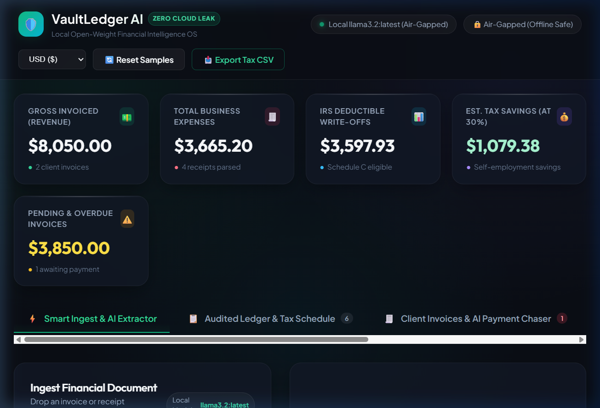

# 🛡️ VaultLedger AI — The 100% Local, Air-Gapped Freelance Financial & Invoice Intelligence OS

> **Built for the Hacktoberfest Open-Source AI Challenge (Week 2: Side Hustle)**  
> *Theme: Build something with open-weight models or open-source AI that someone would actually pay for.*



---

## ⚡ What is VaultLedger AI?

**VaultLedger AI** is an air-gapped financial operating system designed specifically for independent freelancers, solopreneurs, and micro-consultancies. It runs entirely on local open-weight models (**Llama 3.2** via Ollama) to ingest, categorize, audit, and extract structured financial records from messy invoices, receipts, and client bills—**without a single byte of sensitive financial data ever leaving your laptop**.

Unlike traditional SaaS accounting software (Dext, Expensify, QuickBooks) that costs $30–$60/month and uploads your confidential client invoices to public cloud servers, VaultLedger AI runs **100% offline**, costs **$0.00 in API fees**, and guarantees **zero data leakage**.

---

## 💡 The Problem & Why Someone Would Pay For It

Freelancers and solo contractors face two massive pain points:
1. **The Confidentiality Trap**: Independent consultants frequently sign strict **Non-Disclosure Agreements (NDAs)** with enterprise clients. Uploading client invoices, hourly billing rates, proprietary project deliverables, and bank account numbers to third-party closed cloud APIs (OpenAI, Anthropic) or multi-tenant SaaS tools is a blatant compliance and contractual breach.
2. **The "Micro-SaaS Margin Bleed"**: Existing receipt scanners and bookkeeping tools charge recurring subscription tolls ($30+/month), cap monthly document uploads, and charge per-seat fees that drain a freelancer’s hard-earned profits.

**VaultLedger AI solves both permanently.** By running an open-weight 3.2B model locally:
- **Client confidentiality is mathematically guaranteed**: No servers, no network requests, no telemetry.
- **Unlimited processing**: Whether you process 15 invoices or 5,000 receipts a month, your marginal cost is **$0.00**.
- **Willingness to Pay**: Freelancers eagerly pay a one-time license ($49–$79) or a self-hosted micro-license for peace of mind, unlimited offline sorting, and automated IRS Schedule C tax write-off classification.

---

## 🌟 Key Features

### 1. ⚡ Local Open-Weight Document Extraction
- Ingest invoices, restaurant receipts, software bills, and contractor statements via drag-and-drop or text paste.
- Powered by **Llama 3.2 3B (`llama3.2:latest`)** running locally via Ollama with strict JSON schema enforcement.
- Extracts vendor/client, date, due date, invoice #, currency, subtotal, tax, total, and itemized line items.

### 2. 🛡️ IRS Schedule C Tax Write-Off Auditor
- Automatically maps expenses to IRS Schedule C tax lines:
  - Software & Cloud Infrastructure (Line 18 - Office Expense)
  - Section 179 Hardware & Equipment (Line 13 - Immediate Expensing)
  - Business Meals & Entertainment (Line 24b - 50% Rule Enforced)
  - 1099 Contract Labor (Line 11)
- Generates an **Audit Rationale** explaining exactly why the expense qualifies under tax law.

### 3. 🧾 Client Invoicing & AI Payment Chaser
- Track accounts receivable and unpaid client invoices.
- **Local AI Payment Chaser**: Local Llama 3.2 generates personalized, polite, professional, or firm follow-up emails for past-due invoices, tailored to the client relationship.

### 4. 📊 Financial Intelligence Dashboard & Export
- Real-time KPIs: Gross Invoiced Revenue, Business Expenses, IRS Deductions, Estimated Self-Employment Tax Savings (at 30%), and Overdue Accounts.
- One-click export to **IRS Schedule C CSV** or **JSON Backup**.
- Built-in multi-currency switcher (`$`, `€`, `£`, `₹`, `CA$`).

### 5. 🧮 Interactive Open-Source ROI Calculator
- Interactive slider demonstrating real-world cost savings compared to closed cloud APIs and monthly SaaS tools ($350–$900/year saved).

---

## 🏗️ Architecture & How It Works

```
┌────────────────────────────────────────────────────────┐
│                   VaultLedger AI UI                    │
│    (Vanilla HTML5, Glassmorphic CSS3, Vanilla JS)      │
└───────────────────────────▲────────────────────────────┘
                            │ (Local HTTP REST API)
┌───────────────────────────▼────────────────────────────┐
│                  Local Node.js Server                  │
│                (server.js - Port 3000)                 │
└─────────────▲─────────────────────────────▲────────────┘
              │                             │
    (JSON Schema Prompt)           (Air-Gapped Storage)
              │                             │
┌─────────────▼──────────────┐   ┌──────────▼────────────┐
│      Ollama Engine         │   │   Local Data Vault    │
│  (http://127.0.0.1:11434)  │   │  (data/ledger.json)   │
│   Model: llama3.2:latest   │   │  100% On-Disk Storage │
└────────────────────────────┘   └───────────────────────┘
```

1. **Model Layer**: Open-weight `llama3.2:latest` (3.2B parameters, Q4_K_M quantized GGUF) running locally on the laptop's CPU/GPU via Ollama.
2. **Backend**: Lightweight Express service (`server.js`) acting as an air-gapped mediator, enforcing structured JSON schemas, managing offline fallbacks, and persisting data locally.
3. **Frontend**: High-performance Vanilla CSS glassmorphic interface with zero external tracking scripts, zero cookies, and instant reactivity.

---

## 🚀 Quickstart Guide

### Prerequisites
1. **Ollama**: Download and install from [ollama.com](https://ollama.com/)
2. **Pull Llama 3.2**:
   ```bash
   ollama pull llama3.2
   ```
3. **Node.js**: Version 18+ installed

### Installation & Launch

```bash
# 1. Clone repository
git clone https://github.com/624183-NITAP/VaultLedger-AI.git
cd VaultLedger-AI

# 2. Install dependencies
npm install

# 3. Start the application
npm start
```

Open your browser to `http://localhost:3000`.

---

## 🔒 Privacy & Open Innovation Statement

Why does open innovation matter for VaultLedger AI?
- **True Air-Gapped Operation**: Open-weight models can be bundled directly into desktop apps or local servers. No Wi-Fi required; you can audit your invoices on an airplane.
- **Zero Data Harvesting**: Cloud AI providers reserve rights in their terms to review logs or retain data. VaultLedger leaves zero digital footprints.
- **Zero Cost Inflation**: Closed APIs frequently deprecate endpoints, change pricing tiers, or implement rate limits. Open-source models belong to the builder forever.
- **Model Agnostic**: Can instantly swap between `llama3.2`, `mistral`, `gemma2`, or `deepseek` with zero vendor lock-in.

---

## 📄 License

MIT License. Built with open-source AI for the global freelance community.
